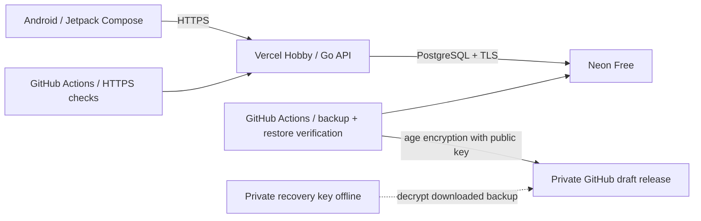

# Бесплатный публичный тестовый сервер

Публичный API MoneyFlow: **[https://moneyflow-api-two.vercel.app/](https://moneyflow-api-two.vercel.app/)**. Для личного тестирования используется Vercel Hobby для Go API, Neon Free для PostgreSQL и GitHub Actions для внешнего мониторинга и зашифрованных резервных копий. Домен `*.vercel.app` и HTTPS предоставляются Vercel; покупать VPS, домен или S3-хранилище не нужно. Этот runbook описывает первоначальную настройку, обновления, мониторинг и восстановление данных. Проекты MoneyFlow называются `moneyflow-api` в Vercel и `moneyflow-database` в Neon.



## Условия бесплатного тестирования

| Сервис | Что используется | Граница бесплатного варианта |
| --- | --- | --- |
| Vercel Hobby | Go API, HTTPS, адрес `*.vercel.app` | Личное некоммерческое использование; при исчерпании лимитов функции могут приостанавливаться |
| Neon Free | PostgreSQL с автоматическим отключением при простое | На 12 октября 2026 года: 1 GB БД и 100 CU-hours на проект в месяц |
| GitHub Actions | Стандартный Ubuntu runner в публичном репозитории | Минуты стандартных runner бесплатны |
| GitHub draft release | Зашифрованные копии, семь последних групп | GitHub не устанавливает суммарную квоту release assets; наш workflow ограничивает архив 20 MiB |

Источники: [Vercel Hobby](https://vercel.com/docs/plans/hobby), [Neon Free: обновление от 2 октября 2026](https://neon.com/blog/neon-free-plan-1-gb-per-project), [GitHub Actions billing](https://docs.github.com/en/billing/concepts/product-billing/github-actions), [хранилище GitHub Releases](https://docs.github.com/en/repositories/releasing-projects-on-github/about-releases).

Оставьте проекты на тарифах **Hobby / Free**, без платных дополнений. Backup сохраняет только зашифрованные файлы в непубликуемом draft release `moneyflow-encrypted-backups`; Actions artifacts для этих копий не используются. Другие задачи CI могут создавать APK-артефакты и расходовать общую квоту Actions/Packages аккаунта. Для них оставьте короткое хранение и остановку платного использования в GitHub Billing. Не переходите на платный тариф автоматически.

Для Neon оставьте scale-to-zero и небольшой compute. Первое обращение после простоя может быть медленнее. Монитор запускается четыре раза в сутки, чтобы проверками не держать базу постоянно активной. Бесплатная схема подходит для тестирования и личного pet-проекта; круглосуточная гарантия доступности в неё не входит.

## 1. Создать PostgreSQL в Neon

1. Зарегистрируйтесь в [Neon](https://neon.com/) и создайте проект на **Free**, PostgreSQL **18**. Выберите регион рядом с регионом функции Vercel. Подготовленный проект называется `moneyflow-database`, тариф `free_v3`.
2. Создайте отдельную БД MoneyFlow. Получите строку подключения через кнопку **Connect**.
3. Сохраните два варианта строки: pooled URL для API и **direct URL** без `-pooler` в имени хоста для миграций и backup.
4. Используйте проверку TLS `sslmode=verify-full`; сохраните остальные параметры подключения Neon. Пароли и URL с паролем храните в настройках секретов, без коммита в Git. На Windows проверке TLS нужна доверенная цепочка CA. Если системное хранилище недоступно библиотеке подключения, укажите существующий доверенный CA bundle параметром `sslrootcert` в URL, URL-кодируя путь. В контейнерном backup используется системный CA bundle Linux. Не снижайте проверку TLS ради обхода ошибки сертификата.

До запуска API примените миграции к этой отдельной тестовой базе. Сервер не должен автоматически мигрировать БД при каждом запуске функции. Локальный runner находится в `backend/cmd/migrate` и запускается с переменной `DATABASE_URL`, содержащей direct URL. Установка Go должна соответствовать версии из `backend/go.mod`.

В PowerShell парольная строка вводится скрыто и удаляется из окружения после команды:

```powershell
cd backend
$taskDsnSecure = Read-Host 'Neon direct DATABASE_URL (sslmode=verify-full)' -AsSecureString
$taskDsnPlain = [System.Net.NetworkCredential]::new('', $taskDsnSecure).Password
try {
    $env:DATABASE_URL = $taskDsnPlain
    go run ./cmd/migrate
    if ($LASTEXITCODE -ne 0) { throw 'Миграции завершились с ошибкой; запуск API нужно отложить.' }
} finally {
    Remove-Item Env:DATABASE_URL -ErrorAction SilentlyContinue
    $taskDsnPlain = $null
    $taskDsnSecure = $null
}
```

Не вводите строку подключения прямо в команду: она попадёт в историю терминала. Выполненная миграция должна завершиться сообщением `database migrations applied`.

## 2. Подключить API к Vercel Hobby

Импортируйте `drissakov/moneyflow` в свой личный проект Vercel Hobby. Подготовленный проект называется `moneyflow-api`. Go-модуль проекта расположен в `backend/`; настройте **Root Directory = backend**, **Framework Preset = Go**. `backend/vercel.json` использует команду `go build -buildvcs=false -o server ./cmd/api`; существующий Go сервер обслуживает все API пути. Для публикации через CLI запускайте `vercel deploy` из корня репозитория. Не выбирайте платный trial. Создайте переменные окружения для тестового публичного deployment:

| Переменная | Значение |
| --- | --- |
| `DATABASE_URL` | Neon **pooled** PostgreSQL URL с проверкой TLS |
| `APP_ENV` | `production` |
| `SESSION_TTL` | `168h` |
| `FRANKFURTER_URL` | `https://api.frankfurter.dev/v2` |
| `FX_CACHE_TTL` | `6h` |
| `FX_MAX_STALE` | `168h` |
| `GIN_MODE` | `release` |
| `DATABASE_MAX_OPEN_CONNECTIONS` | `4` |
| `DATABASE_MAX_IDLE_CONNECTIONS` | `0` |
| `DATABASE_CONNECTION_MAX_IDLE_TIME` | `30s` |
| `METRICS_PORT` | Не задавать для бесплатного serverless варианта |

Значение `DATABASE_URL` должно быть секретом. Маленький пул и отсутствие постоянно открытых idle-соединений позволяют Neon отключать compute при простое. В serverless варианте постоянно работающий metrics listener и фоновый опрос БД не включаются. Не подключайте production БД к произвольным preview-веткам. Для preview используйте отдельную тестовую БД или не задавайте её секрет.

Публикуйте API **после успешных миграций**. Для обновлений со сменой схемы сначала создайте проверенную резервную копию, примените совместимые миграции, затем опубликуйте проверенный коммит `main`. Не допускайте автоматического Git deployment новой версии API до выполнения её миграций. Возврат старого кода не отменяет миграции базы.

После deployment проверьте в браузере:

```text
https://moneyflow-api-two.vercel.app/healthz  → {"status":"ok"}
https://moneyflow-api-two.vercel.app/readyz   → {"status":"ready"}
```

URL должен открываться без страницы входа Vercel: мобильное приложение и монитор должны обращаться к публичному production API. Настройте deployment protection соответственно. Учётные данные самого MoneyFlow остаются обязательными для личных финансовых данных.

## 3. Подключить Android

Откройте `android/` в Android Studio. В локальных Gradle properties задайте:

```properties
MONEYFLOW_API_URL=https://moneyflow-api-two.vercel.app/
MONEYFLOW_RELEASE_API_URL=https://moneyflow-api-two.vercel.app/
```

Или установите debug-сборку командой:

```powershell
cd android
.\gradlew.bat :app:installDebug -PMONEYFLOW_API_URL=https://moneyflow-api-two.vercel.app/
```

Завершающий `/` обязателен. Создайте тестового пользователя, счёт, доход и расход; проверьте категории, аналитику и мультивалютность. В этом варианте приложению нужен интернет; локальный API `10.0.2.2:8080` заменяется публичным HTTPS URL. Release APK пока не имеет настроенной подписи; для установки используйте debug-сборку.

## 4. Зашифрованные автоматические backup

Копии шифруются **age** публичным ключом владельца. Приватный ключ остаётся у вас и не нужен GitHub для создания копии. Установите age из [официального проекта](https://github.com/FiloSottile/age), затем **локально** создайте ключ:

```text
age-keygen -o moneyflow-backup-key.txt
age-keygen -y moneyflow-backup-key.txt
```

Второй вывод вида `age1...` — публичный ключ. Приватный `moneyflow-backup-key.txt` храните вне репозитория, в защищённом менеджере/зашифрованной папке и с независимой копией. Без него восстановить архив невозможно.

В GitHub откройте **Settings → Secrets and variables → Actions**:

| Тип | Имя | Значение |
| --- | --- | --- |
| Secret | `MONEYFLOW_BACKUP_DATABASE_URL` | Neon **direct** URL этой тестовой БД, с проверкой TLS |
| Variable | `MONEYFLOW_BACKUP_AGE_RECIPIENT` | Публичный ключ `age1...` |
| Variable | `MONEYFLOW_FREE_BACKUPS_ENABLED` | `true` |

Запустите **Actions → Free encrypted database backup → Run workflow** на `main`. Успешный job снимает согласованный архив PostgreSQL, восстанавливает его в изолированную PostgreSQL 18 на runner, сверяет содержимое и только после проверки шифрует и загружает архив. Незашифрованные данные не загружаются в GitHub. Далее job запрашивается ежедневно в **03:17 UTC**; сохраняются семь последних групп копий. Каждая группа содержит `.tar.age`, его `.sha256` и `.verification.json`. Имена включают ID запуска и номер попытки. Проверочный receipt загружается последним и обозначает завершённую группу; неполная загрузка не считается успешной копией.

Копии находятся в **Releases → draft `moneyflow-encrypted-backups`**. Он остаётся неопубликованным; workflow останавливается, если этот release был опубликован вручную. Draft доступен аутентифицированным пользователям с push/write-доступом к репозиторию ([правила GitHub](https://docs.github.com/en/rest/releases/releases#list-releases)). Не нажимайте **Publish release**. Шифрование сохраняет защиту финансовых данных независимо от доступа к release. Для создания файлов workflow использует ограниченный этим репозиторием `GITHUB_TOKEN` с `contents: write`; отдельный PAT или приватный age-ключ не нужен.

После первого успешного backup откройте этот draft release под владельцем репозитория, скачайте три файла одной группы и выполните независимый тест восстановления. Сверьте SHA-256 файла `moneyflow-backup-RUN_ID-ATTEMPT.tar.age` с его `.sha256` (например, `Get-FileHash -Algorithm SHA256` в PowerShell). Замените `RUN_ID` и `ATTEMPT` на фактические числа в скачанном имени. Расшифровка:

```text
age --decrypt -i moneyflow-backup-key.txt -o moneyflow-backup.tar moneyflow-backup-RUN_ID-ATTEMPT.tar.age
mkdir moneyflow-restore
tar -xf moneyflow-backup.tar -C moneyflow-restore
```

В папке будут `moneyflow.dump`, `manifest.jsonl` и `format-version`. Восстановите dump **в новую отдельную PostgreSQL 18**, используя клиент PostgreSQL 18:

```text
pg_restore --exit-on-error --clean --if-exists --no-owner --no-acl --dbname=RESTORE_DATABASE moneyflow-restore/moneyflow.dump
```

`--clean --if-exists` подготавливает объекты только в выбранной новой базе; в том числе заменяет стандартную схему `public`, которую архив создаёт заново. Команда удаляет совпадающие объекты, поэтому `RESTORE_DATABASE` должна быть отдельной проверочной базой. Не запускайте её против действующей MoneyFlow БД. Версия `pg_dump` должна быть не ниже основной версии исходной БД; восстановление в старую основную версию PostgreSQL не поддерживается этим вариантом. Подключение к цели задайте локально через безопасные настройки PostgreSQL. Проверьте вход, счета, категории, операции и аналитику на восстановленной копии. После проверки удалите расшифрованный tar, dump и manifest из временной папки и защищайте их как финансовые данные.

## 5. Внешний мониторинг

Добавьте GitHub Actions variables:

| Имя | Значение |
| --- | --- |
| `MONEYFLOW_API_URL` | `https://moneyflow-api-two.vercel.app/` |
| `MONEYFLOW_FREE_MONITOR_ENABLED` | `true` |

Запустите **Actions → Free API monitoring → Run workflow**. Job проверяет публичный DNS, сертификат HTTPS, JSON `/healthz` и `/readyz`, а при включённых backup — наличие полной группы трёх файлов за последние **30 часов**, соответствующей успешному запуску `free-backup.yml` и номеру его попытки. Монитор также проверяет, что backup release остаётся draft. Если release не виден токену мониторинга, проверка завершится ошибкой, а не ложным подтверждением backup. Проверка выполняется каждые шесть часов, на 23-й минуте. Результат и задержка запросов видны в summary запуска. Failed job отображается в Actions; почтовые уведомления определяются вашими настройками GitHub Actions notifications. Дополнительный канал сообщений автоматически не подключается.

Монитор выполняет только HTTP GET-запросы. Его `GITHUB_TOKEN` всё же требует `contents: write`: GitHub показывает draft releases только токену с push-доступом к репозиторию; `contents: read` возвращает список без приватного draft. Это проверено фактическим запуском workflow. Право `actions: read` используется для проверки успешного backup run. Токен не передаётся публичному API MoneyFlow и не сохраняется в checkout.

Если проверки не проходят, проверьте доступность API и БД, лимиты Vercel/Neon, результат миграций, GitHub variables/secrets и последний backup job. Отдельно следите за фактическим использованием хранилища и compute в панелях провайдеров.

[Планировщик GitHub](https://docs.github.com/en/actions/reference/workflows-and-actions/events-that-trigger-workflows#schedule) может задерживать или пропускать запуски; в публичных репозиториях расписания отключаются после 60 дней отсутствия активности. Периодически проверяйте дату последней копии и при необходимости включайте workflow снова. Это мониторинг для бесплатного тестового размещения с интервалом обнаружения до шести часов; ежедневное расписание backup требует проверки фактических запусков.

## Готовность к использованию

- API открывается по действительному HTTPS URL, `/readyz` подтверждает доступность БД.
- Android создаёт и читает данные через этот URL.
- Первый backup job успешен; скачанная копия расшифрована и восстановлена в отдельной БД.
- Приватный ключ сохранён вне GitHub и хостинга.
- Монитор вручную прошёл проверку API и свежести backup.
- Тарифы остаются Free/Hobby, а платное превышение бюджета Actions остановлено.

Расширенный вариант с отдельным VPS, Prometheus/Grafana и offsite restic находится в [PRODUCTION.md](PRODUCTION.md).
